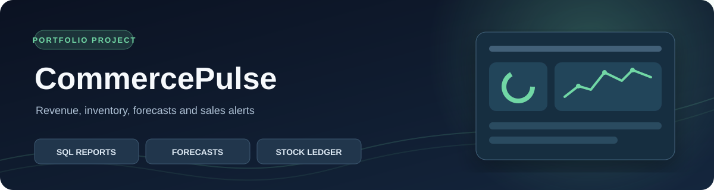
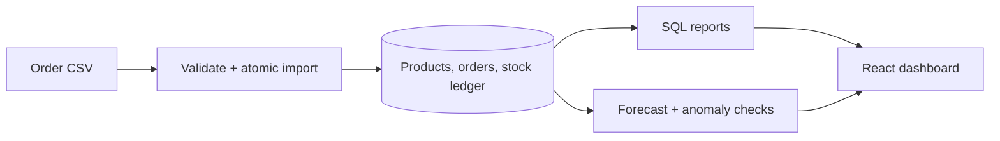

<div align="center">
  

  # CommercePulse

  **Sales and inventory intelligence built on reliable imports and transparent SQL.**

  [Live demo](https://commercepulse-demo.onrender.com/) · [Source code](https://github.com/HARSH-1607/CommercePulse) · [API docs](https://commercepulse-demo.onrender.com/docs)
</div>

> **Explore the demo:** Browse revenue trends, products, stock history, seven-day demand forecasts, and unusual-sales alerts. The public site contains fictional data and blocks writes on the server. Hosted SQLite data may reset after a restart.

## What it does

| Area | Implementation |
| --- | --- |
| Orders and stock | Relational products, orders, order items, and an auditable stock movement ledger. CSV imports validate before writing, use one transaction, and detect conflicting order IDs. |
| SQL analytics | Parameterized joins and aggregations for revenue, gross margin, category mix, daily trends, inventory value, and a window-ranked leaderboard. |
| Forecasting | Ridge regression with trend and weekday features competes with a weekly seasonal baseline on a 14-day holdout. The UI shows the chosen method and validation MAE. |
| Alerts | Median/MAD sales anomaly signals and inventory reorder suggestions support human decisions. |

## Architecture



The stack is Python 3.11+, FastAPI, SQLAlchemy 2, SQLite/PostgreSQL, scikit-learn, React, TypeScript, Recharts, and Vite. The report queries live in [`backend/app/analytics.py`](backend/app/analytics.py).

## Run locally

From the repository root in PowerShell:

```powershell
cd frontend
npm ci
npm run build
cd ..\backend
py -3.11 -m venv .venv
.\.venv\Scripts\python.exe -m pip install -r requirements.txt
$env:COMMERCEPULSE_DEMO = "1"
.\.venv\Scripts\python.exe -m uvicorn app.main:app --host 127.0.0.1 --port 8001
```

Open <http://127.0.0.1:8001>. Demo mode seeds 90 days of fictional orders, and seeding is idempotent. Omit `COMMERCEPULSE_DEMO` for an empty, editable workspace. For frontend development, run `npm run dev` in `frontend` while the API runs on port 8001. Docker is optional: `docker compose up --build` stores SQLite data in a volume. PostgreSQL is supported through `DATABASE_URL`.

## Import format

Download the template from the Orders page. Required columns:

```csv
order_id,ordered_on,sku,quantity,unit_price,channel
NEW-1001,2026-11-07,BREW-MINI,2,89.00,Web
```

Use an ISO date, an existing SKU, a positive integer quantity, and a USD price with at most two decimals. An order may span multiple rows. Reimporting identical orders is safe; conflicting use of an order ID returns `409`. An invalid row rolls back the whole file. Files are limited to 2 MB or 10,000 lines.

## API and verification

| Route | Purpose |
| --- | --- |
| `GET /api/reports/overview?days=30` | Revenue, margin, trend, category, and product reports |
| `GET/POST /api/products` | Browse or add products |
| `POST /api/products/{id}/adjust`, `GET /api/products/{id}/movements` | Adjust stock and inspect its ledger |
| `GET /api/orders`, `POST /api/orders/import` | Browse orders and import a CSV |
| `GET /api/forecast`, `GET /api/alerts` | Demand outlook and sales/stock signals |

Interactive API documentation is at `/docs`. Run `cd backend; .\.venv\Scripts\python.exe -m pytest -q` for tests covering reports, signals, idempotent and atomic imports, stock movements, and invalid CSVs.

## Limits

The editable local app has no authentication or tenant isolation; keep it on localhost and use fictional data. The hosted demo enforces read-only access server-side. Currency is USD. Forecasts use short daily histories and omit promotions, holidays, returns, and supplier constraints. Review predictions and alerts before making inventory decisions.
